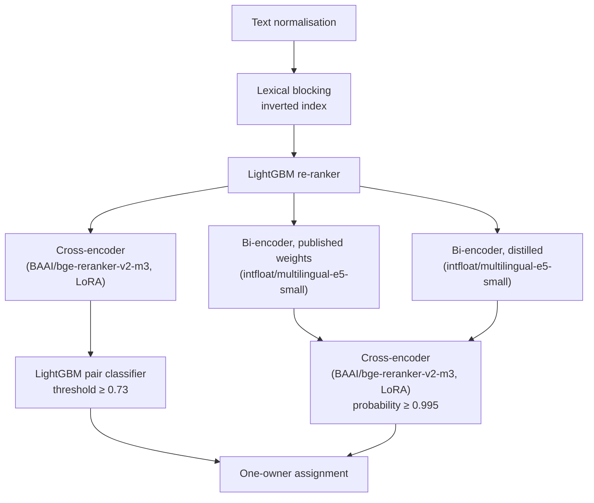

# ML Challenge 2026: Business Entity Resolution Solution Template

**Team Name:** VadaPav  
**Team Members:** Prathamesh Kinagi, Ajinkya Jagdish Pathak, Aayush Kulkarni, Aarush Oak (Pune Institute of Computer Technology)  
**Submission Date:** 2026-09-27

---

## 1. Executive Summary

Each Source-1 record is linked to the Source-2 and Source-3 records that are the same business, and the score is macro-averaged F0.5. An inverted index and a LightGBM re-ranker propose candidates; the lexical branch is a fine-tuned cross-encoder and a LightGBM pair classifier at probability ≥ 0.73, while a published bi-encoder and a distilled bi-encoder run in parallel and the same cross-encoder admits a new pair only at probability ≥ 0.995. Fine-tuning is LoRA on `BAAI/bge-reranker-v2-m3`, distillation trains a second `intfloat/multilingual-e5-small` with InfoNCE and MarginMSE, and isotonic calibration maps the pair-classifier scores before one-owner assignment.

This package is submission 18. Public F0.5 is 0.984075. `output/matching_results.tsv` has 5,812,655 matches (sha1 `7334635ce65ff93c9b1ca02395f48860e343de49`). `output/candidate_pairs.tsv` has 17,546,805 pairs, 10.13 per S1 (sha1 `8c97a66b9d08ef722d6cf34b2760c963f9c1e3b9`).

---

## 2. Methodology

### 2.1 Problem Analysis

Training and test differ in size, script, and country coverage. The pipeline treats country as an open string and learns the copy patterns below from the training links.

**Sizes:** Training has 2,206,821 S1 records, 5,034,616 S2 records, 5,285,603 S3 records, and 7,638,365 true links. Test has 1,732,544 S1 records and a pool of 9,969,589.

**Link structure:** An S1 has from 0 to 11 true pool records. The mean is about 3.45. 5.59% of S1 records have none. A pool record has at most one S1 owner. A true link stays inside one country. Record ids and file order carry no signal. Over 300,000 true pairs, the Spearman correlation with id is −0.002 and with row order is 0.001, the same as a shuffle.

**Scripts:** S1 names are Latin only. 752,869 training-pool names are written in one of nine Indic scripts.

**Missing fields:** About 345,000 training-pool addresses are empty. About 87,000 more are the literal `<NULL>`.

**Noise on true copies:** The same business is written in more than one surface form.

- Legal-suffix variation: Pvt, Private, Ltd, LLC.
- Word-order transposition: "Concepts-Co Digital Value" for "Value Digital Concepts".
- Accent or typo: "Límited", "8eat Milk".
- A website in the name field: "urbanconstruction.com".
- Both scripts in one address: "Thane, महाराष्ट्र".
- A damaged house number: "4900" against "490".

Pairs we accept with disagreeing house numbers are still 99.6% correct.

**Chains:** Many S1 records share a name. Among S1 records that share their name with at least nine others, only 24.7% of the true links have that exact name on the pool side.

**Country:** France appears only in test. Country is a string on the record. Retrieval stays inside one country. The pair classifier sees whether the two country strings match.

### 2.2 Solution Strategy

The lexical branch scores candidates with the fine-tuned cross-encoder and the LightGBM pair classifier accepts a pair at probability ≥ 0.73. In parallel, the published bi-encoder and the distilled bi-encoder retrieve pool records, and the same cross-encoder admits a new pair only at probability ≥ 0.995. Both branches end at one-owner assignment.

**Approach Type:** Inverted-index blocking, a LightGBM re-ranker, then two parallel branches that meet at one-owner assignment. The lexical branch is a fine-tuned cross-encoder and a LightGBM pair classifier at probability ≥ 0.73. The retrieval branch is a published bi-encoder and a distilled bi-encoder, and the same cross-encoder admits a new pair only at probability ≥ 0.995.

**Core Innovation:** LoRA fine-tuning of `BAAI/bge-reranker-v2-m3` on our S1–pool pairs, distillation of that cross-encoder into `intfloat/multilingual-e5-small` with in-batch InfoNCE and MarginMSE, and features for a pool record that has a name and an empty address.

**Lexical path:** Normalisation is shared by every stage. The inverted index proposes about 290 candidates per S1. The LightGBM re-ranker cuts that list to about 6.1. The pair classifier, an 85-feature LightGBM, keeps a pair when the isotonic-calibrated probability is at least 0.73. The trees themselves were selected at 0.70.

**Second search:** A business has about 3.45 pool records. After one copy is accepted, the nearest embeddings are often the other copies. The inverted index misses many of them. The pool name may be in an Indic script while the S1 name is Latin. The name field may be a website. The address may be blank, so the address postings never fire.

**Training split:** Train S1 is split 80/20. The 20% slice is 441,363 S1 records and is used only for scoring. Inside the 80%, separate slices tune blocking, train the re-ranker, fine-tune the cross-encoder, and train the pair classifier. S2 and S3 are never split, so every query searches the full pool. Classifier comparisons use 5-fold GroupKFold by S1. Deltas are paired per S1 with a bootstrap 95% interval. The cross-encoder probability on a classifier training row comes from an S1 that cross-encoder was not trained on. Official test labels were not used.

---

## 3. Candidate Generation (Blocking)

Candidate generation has three stages. An inverted index proposes a wide list. A LightGBM re-ranker cuts it. A bi-encoder, run after the first accepts, proposes pairs the index never built a key for.

**Blocking keys used:** EN, NT, NG, NP, SP, NC, AT, AB, XK. The table below is how each family is built. Metaphone and Soundex are similarity features on a candidate pair. They are not families in this index.

**Candidate pairs generated:** 17,546,805 pairs, 10.13 per test S1. The re-ranker cut alone is about 6.1 per S1. The rest are bi-encoder pairs scored by the cross-encoder.

**How we ensured true matches were not lost:** On the tuning slice the stage-1 ceiling F0.5 is 0.9957 and entity recall is 0.9993. After the re-ranker, validation entity recall is 0.9984 and the ceiling F0.5 is 0.9928. On 180,000 training S1 records, 2.43% of true pairs were outside the re-ranker list, and the bi-encoder pass is what retrieves those.

### Normalisation

The same function runs on S1 and on the pool. Text is converted to Unicode NFC. The nine Indic scripts are romanised. Accents and case are folded, `&` becomes `and`, and punctuation is removed. Abbreviation maps are counts of token pairs in the unlabelled pool, grouped by the country string on the record. A short token is rewritten to a longer one when those contexts agree, including the pair `r` and `rue`. A transliteration map is counted from training pairs in this dataset. Both maps are estimated here. No outside street list or name list is used.

### Inverted index

Nine families are hashed into an inverted index. Each key is a 64-bit hash. The postings are memory-mapped. A key is dropped when its document frequency exceeds that family’s cap. Metaphone and Soundex are similarity features on a candidate pair. They are not families in the index that was built.

| Family | Built from |
|---|---|
| EN | The whole normalised name |
| NT | Name tokens of length at least 2 |
| NG | Character 3-grams of the name |
| NP | Pairs among the first 8 name tokens |
| SP | Pairs of the consonant skeletons of those tokens |
| NC | The name concatenated, with edge tokens stripped, plus long pool tokens |
| AT | Address tokens |
| AB | Address bigrams |
| XK | The name skeleton crossed with a rare address token |

A logistic model scores the union of these families. Per-channel quotas keep about 290 candidates per S1. On a tuning slice, if every surviving candidate were classified perfectly, F0.5 would be 0.9957. Entity recall on that slice is 0.9993.

### LightGBM re-ranker

The re-ranker is a LightGBM binary classifier with 35 features. It sorts the candidates the inverted index returned. Rank is by the re-ranker probability, then by the stage-1 logistic score, then by pool index.

It keeps rank 5 or better, or any candidate with probability at least 0.05 and rank at most 60 (`configs/blocking.json`). Test S1 then has 6.13 candidates on average.

On the 441,363 validation S1 records, entity recall is 0.9984 and the ceiling F0.5 is 0.9928. The pair classifier in section 4 makes the lexical match decision. Only this probability and this rank are passed on.

Training rows, in `src/ber/rerank.py`, are every true candidate in that union, the 100 non-matches with the highest logistic score, and 100 random non-matches. Each random non-match is weighted by the size of the remainder divided by how many were drawn. The objective in `configs/blocking.json` is binary logloss.

The 35 columns are nine per-family blocking scores, five coverage fractions (the share of the query’s NT, NG, NP, AT, and XK key weight that the candidate hit), the stage-1 logistic score, and the rank in the logistic channel, the name channel, and the address channel.

Three further columns are log1p of the union size, of the exact-name document frequency, and of how many S1 share the query name.

Fuzzy name scores are token-set ratio, full ratio, partial ratio, Jaro–Winkler on the sorted concatenation, and skeleton Jaccard. Fuzzy address scores are token-set and token-sort ratios, and they are 0 when either address is empty.

Flags are an empty-address code, postal-token agreement, country-string agreement, S2 versus S3, an Indic pool name, and the two token counts.

### Bi-encoder search

This search runs after the seed matcher has accepted some pool records. Both encoders are `intfloat/multilingual-e5-small` (118M parameters, MIT), the same architecture. Retrieval text is `query: name | address`, truncated at 64 tokens. The vector is the mean of the token states over the attention mask, then L2-normalised.

Search is exact cosine, one country at a time (`src/ce/hf_job/retrieve_job.py`). A pair already in the re-ranker list is not sent again. A pool record the current base file already assigns is not sent.

These pairs never enter the 85-feature LightGBM, because they have no re-ranker score. Section 4 is how the second copy is trained and how a pair is admitted.

**Published weights:** This copy is the published checkpoint, with no fine-tuning. The search returns 5 neighbours. Each S1 keeps its 5 nearest pool records (`--k1 5`). Each pool record the seed matcher has accepted keeps its 2 nearest other pool records (`--k2 2` in `src/reproduce.py`).

Ranks 3–5 of that same seed search are a separate slice: the stored neighbours go to rank 5, and `src/pipeline/seed5_test_pairs.py` keeps seed rank 3 and above. Pool records already assigned by the lexical decisions at 0.70, or by distilled ranks 1–5, are dropped before those ranks are scored.

The seed matcher is an earlier LightGBM on the 68 string, list, and record features plus the cross-encoder probability. It only seeds copy expansion and the accepted set used for the test group profile. The 85-feature classifier in section 4 writes the final lexical decisions.

**Distilled copy at test:** The second copy retrieves 10 neighbours per S1. The pipeline keeps ranks 1–2, then 3–5, then 6–7, then 8–10, each band dropping pairs already scored. Those bands are submissions 12, 13, 17, and 18.

The cross-encoder scores a bi-encoder pair when that pair is outside the re-ranker list and the pool record is still unassigned. A pair is added when the cross-encoder probability is at least 0.995.

One-owner assignment then runs on the union with the lexical decisions at 0.73: a pool record the classifier already holds stays there, and among new claims the higher probability is kept.

The submitted candidate file is every pair a model scored: the re-ranker lists, plus every bi-encoder pair sent to the cross-encoder. That is 17,546,805 pairs, 10.13 per test S1. The re-ranker cut by itself is about 6.1 per S1.

On 180,000 training S1 records against the full 10.3 million training-pool records, 15,117 of 621,534 true pairs (2.43%) are missing from the re-ranker lists. Frozen retrieval at 5 neighbours per S1 plus 5 neighbours of each accepted record recovers 44.1% of those misses.

The distilled query recovers 47.7% of the Indian misses at 5 neighbours, against 24.4% for the frozen model. The test file goes deeper: distilled ranks through 10, and frozen copy expansion as ranks 1–2 plus ranks 3–5.

---

## 4. Matching Model

The lexical decision and the bi-encoder decision share one cross-encoder probability. On a lexical pair that probability is one column of a LightGBM. On a bi-encoder pair it is the decision itself, at 0.995. The subsections below are the fine-tune, the distillation, and the pair classifier.

### Cross-encoder fine-tuning

The cross-encoder reads both records in one forward pass. Each side is `name | address`, truncated at 128 tokens. 0.06% of pairs are longer than that.

The base model is `BAAI/bge-reranker-v2-m3` (568M parameters, Apache-2.0), loaded as a sequence classifier with one logit. At scoring, the probability is the sigmoid of the logit.

**Training:**

- The training loss is binary cross-entropy on that logit (`BCEWithLogitsLoss` in `src/ce/train_continue.py`).
- Fine-tuning is LoRA with rank 16, alpha 32, and dropout 0.05, on the query, key, and value projections and on the classifier head. That is 3.4 million trainable parameters. The saved adapter records those ranks and targets.
- Epoch 1 is one pass over 971,466 pairs. Those S1 are later excluded from the pair-classifier fit, so the probability on the fit rows is out of sample.
- Epoch 2 continues from that adapter for one more epoch, in `src/ce/train_continue.py`, on DEV_REST_REST fold 0. Fold 0 and fold 1 split that S1 set by the top bit of `s1_idx` multiplied by `0x9E3779B1`. Fold 0 is 3,285,477 new pairs.
- The optimiser is AdamW with weight decay 0.01, and gradients are clipped at 1.0.
- The schedule warms up linearly over 3% of the planned steps, then multiplies the learning rate by one minus the larger of the step fraction and the elapsed fraction of the wall-clock budget. `src/reproduce.py` sets that budget to 8.5 hours.
- The learning rate is 5e-5, the batch size is 32, and the device is one T4 in fp16. CUDA capability below 8 selects fp16 and a gradient scaler. The recorded run on one T4 finished in 6.5 hours.
- Inside the fold, 5% of the fold’s S1, capped at 30,000 pairs, is the checkpoint set, and the saved adapter is the one with the lowest held-out logloss.

On MATCH_VALID, which neither epoch trained on, epoch 2 reaches AUC 0.99896 and logloss 0.0402. After epoch 1 those figures were 0.99841 and 0.0507.

The pair classifier uses only this epoch-2 probability. Extra transforms of that score, including its rank, its margin, its logit, and products with the string features, moved F0.5 by at most ±0.00008.

### Distillation

The student is `intfloat/multilingual-e5-small` (118M parameters, MIT), the same architecture as the published copy. Retrieval text on both sides is `query: name | address`, truncated at 64 tokens.

The vector is the mean of the token states over the attention mask, L2-normalised. At test, search is exact cosine inside one country.

The teacher is the fine-tuned cross-encoder probability.

**Training:**

- Triplets are built by `src/pipeline/distill_e5.py` from DEV_REST_REST fold 1, the half the cross-encoder did not train on, and the S1 slice held out of the retrieval evaluation on MATCH_TRAIN.
- The dump uses the script default of 150,000 S1 and writes 435,454 triplets. `src/ce/hf_job/distill_job.py` trains on that file.
- The loss is in-batch InfoNCE plus MarginMSE. In a batch, each query’s logits are its cosine against every positive and every negative in the batch, divided by temperature 0.05, and the cross-entropy target is the query’s own positive.
- MarginMSE is the squared error between the student’s cosine margin, cosine to the positive minus cosine to the negative, and the teacher’s probability margin. The MarginMSE term is multiplied by LAM 1.0, and the two terms are added.
- Training is one epoch, batch 128, AdamW at learning rate 2e-5 with weight decay 0.01, a OneCycle schedule that spends the first 6% of steps warming up, and gradient clipping at 1.0.
- On CUDA the forward pass is bf16. The recorded run took 7 minutes on one A100.

For each of those S1, a positive is a true pool record. If the true pair is in the candidate list, the teacher probability is the cross-encoder score. If the inverted index missed it, the teacher probability is set to 0.999.

The negatives are the two false candidates in the list with the highest teacher probability. Each positive is then paired with one of those two, so a triplet is the S1 text, a true pool record, and one hard negative.

At test the distilled model retrieves 10 neighbours per S1. The pipeline keeps ranks 1–2, 3–5, 6–7, and 8–10 as separate slices, which are submissions 12, 13, 17, and 18.

The published copy is the other retrieval: S1 top 5 and 2 neighbours of each seed-matcher acceptance.

Bi-encoder pairs skip the 85-feature LightGBM. They are admitted only when the cross-encoder probability is at least 0.995, and only when the pool record is still unassigned. One-owner then runs on the union with the 0.73 classifier decisions.

A LightGBM on retrieval provenance matched that 0.995 rule to within −0.00001 F0.5. Pairs added at 0.99 were 97.9% correct.

### LightGBM pair classifier

**Model type:** LightGBM binary classifier, logloss, 85 features, no class weights. Lexical pairs only. A bi-encoder pair has no re-ranker score, so this matrix is never built for it, and the cross-encoder admits it at probability ≥ 0.995.

A missing value is left as NaN. LightGBM treats NaN as missing.

S1 records used to fine-tune the cross-encoder are left out of this fit: the epoch-1 S1 set is dropped entirely, and of DEV_REST_REST only fold 1 is kept, so the epoch-2 training S1 are out as well. The cross-encoder probability on the fit rows is out of sample.

**Threshold selection method:** Isotonic calibration on 10% of S1 held out from fitting. Trees selected at 0.70 (calibration-slice F0.5 0.98643). That slice is the held-out 10% of S1. It is not a 5-fold out-of-fold score.

Submitted decisions use the same trees at ≥ 0.73. Train F0.5 at 0.73 equals train F0.5 at 0.70.

Then one-owner assignment: each pool record is kept for the S1 with the highest score. There is no cap on how many pool records one S1 may receive, so that assignment is optimal for these scores.

**Fit:**

- The fit is `src/pipeline/train_final_comp.py`. The S1 sets are MATCH_TRAIN, MATCH_VALID, and DEV_REST_REST fold 1.
- A seeded permutation of every S1, including the excluded epoch-1 S1, cuts early stopping at `ES_FRAC` 0.05 and calibration at `CAL_FRAC` 0.10, and the fit is the rest, about 85%. Early stopping and calibration use different S1, so the isotonic map is fit on scores the stopping rule never saw.

**Training:**

- The LightGBM block in `configs/match.json` is binary logloss, learning rate 0.05, 63 leaves, minimum 100 rows in a leaf, feature fraction 0.8, bagging fraction 0.8, and L2 penalty 1.0.
- That file’s round cap is 3,000. `src/pipeline/train_final_comp.py` raises the cap to 12,000 and stops after 100 rounds without improvement on the 5% slice.

The fit has 3,864,095 rows. The best iteration is 1,190 of 12,000, and the model file marks the run as not truncated.

**Decision:**

- Isotonic regression maps the raw score onto [0, 1] on the calibration slice, clipping outside the range it saw.
- The shipped `matcher.json` stores threshold 0.70, one-owner on, and calibration-slice F0.5 0.98643. `src/reproduce.py` copies those trees and sets the threshold to 0.73 for the submitted file.
- One-owner zeros every score that is strictly below the best score of the same pool record, then the threshold is applied.

The seed matcher is an earlier LightGBM on the 68 string, list, and record features plus the cross-encoder probability, and it is used only to seed copy expansion and the test group-profile accepted set.

**Features used:** The 85 columns fall into ten buckets: 26 name comparisons, 18 address comparisons, 14 within-list scores, 4 record flags, 4 log1p pool-frequency counts, 2 re-ranker outputs, 7 reverse-name features, 3 name-frequency features, 6 group-profile features, and the cross-encoder probability `ce_p`.

**Name features:** These compare the two normalised names.

- RapidFuzz token-set, token-sort, full, and partial ratios are divided by 100. Jaro–Winkler is computed on the concatenation of the tokens after they are sorted.
- Token Jaccard, IDF-weighted Jaccard and coverage, and the rarest missing token use idf = log1p(pool size / document frequency) from this split’s inverted index. Those token statistics are NaN when either name has no tokens.
- Exact match is stored on the normalised string, after the frequent edge tokens are removed and the remaining tokens are sorted, and after the tokens are concatenated with spaces removed.
- Monge–Elkan is the mean and the minimum of token-level Jaro–Winkler.
- Metaphone and Soundex are set Jaccard of the codes of tokens of length at least 2.
- The character TF-IDF cosine is a hashing vectoriser: word-boundary character n-grams of length 2–4, 2^20 bins, IDF from the pool, then cosine.

`n_tset`, `n_tsort`, `n_ratio`, `n_partial`, `n_jw_sorted`, `n_jacc`, `n_idf_jacc`, `n_idf_qcov`, `n_idf_pcov`, `n_q_miss_maxidf`, `n_p_miss_maxidf`, `n_eq`, `n_eq_core`, `n_eq_nospace`, `n_acronym`, `n_first_eq`, `n_shared_maxlen`, `n_sk_jacc`, `q_ntok`, `p_ntok`, `n_shared_maxidf`, `n_me_mean`, `n_me_min`, `n_metaphone_jacc`, `n_soundex_jacc`, `n_tfidf_cos`.

**Address features:** These compare the two addresses and their digit tokens.

- Token-set, token-sort, and partial ratios are NaN when either address is empty.
- `a_empty` is 0 when both addresses have tokens, 1 when only the S1 does, 2 when only the pool record does, and 3 when both are empty.
- Character 3-gram Jaccard drops spaces. The address TF-IDF cosine uses the same hashing vectoriser as the name.
- Digit tokens have leading zeros stripped.
- `a_longnum` is NaN when neither side has a token of at least 3 digits, 0 when only one side does, 2 when those sets intersect, and 1 when both sides have such tokens and the sets are disjoint.
- `a_house` is 1 or 0 for equality of the first digit token, and NaN when either side has none.
- `a_digits_state` is 3 when the digit-token sets are equal, 2 when they overlap, 1 when both are nonempty and disjoint, 0 when exactly one side has digits, and NaN when neither side has a digit.
- `a_num_minlev` is the minimum Levenshtein distance between the long digit tokens, and NaN when either side has none.
- `a_numstreet` is 1 when a number and the following word match as a pair, and NaN when either side has no such pair.

`a_tset`, `a_tsort`, `a_idf_jacc`, `a_q_miss_maxidf`, `a_p_miss_maxidf`, `a_num_jacc`, `a_num_q_only`, `a_num_p_only`, `a_longnum`, `a_house`, `a_empty`, `a_shared_maxidf`, `a_partial`, `a_char3_jacc`, `a_num_minlev`, `a_numstreet`, `a_digits_state`, `a_tfidf_cos`.

The house-number columns are signals the trees can split on. A hard veto on disagreeing house numbers or postal codes lost 0.014 to 0.078 F0.5. Pairs the model accepts with conflicting numbers are still about 99.5% correct.

**Other:** Re-ranker score and list position, country and source, Indic script, log1p name and address counts, the within-list scores, `ce_p`, reverse-name, name frequency, and the group profile.

- `country3` is 1 when the two country strings match, 0 when both are present and differ, and 2 when either is empty.
- `src` is the pool source, 2 or 3. `pool_indic` marks a pool name that was in an Indic script before romanisation.
- `log_chain` is log1p of how many S1 share the query name. `q_name_cnt`, `p_name_cnt`, `q_addr_cnt`, and `p_addr_cnt` are log1p of how many pool records share that core name, or that address token set, after edge tokens are removed and the tokens are sorted. An empty string is NaN.

The 14 `l_` columns are computed inside one S1’s candidate list.

- `l_n` is the list length. The score columns are the maximum re-ranker probability, the gap to that maximum, the ratio to that maximum, the gap to the next-lower score, and the sum.
- Two columns rank the row by name token-set ratio and by address token-set ratio.
- The rest describe the other candidates: the best other name token-set, the gap of name IDF Jaccard to the best in the list, how many names have token-set ratio at least 0.9, how many addresses do, how many candidates share a long number, and the share of the list from the same source.

`ce_p` is the sigmoid probability from the fine-tuned cross-encoder, and it is the only cross-encoder column in the fit.

Reverse-name columns are filled only for a pool record with an empty address.

- Otherwise they are NaN.
- The encoder is the published `intfloat/multilingual-e5-small`. The query is `query:` plus the pool name, searched against `query:` plus each S1 name, top 20 in the same country (`src/pipeline/rev_prep.py`).
- `rv_in20` is 1 when this S1 is in that list. `rv_rank` is that rank, or 21 when it is absent. `rv_cos` is the cosine to this S1.
- `rv_top` is the cosine of the nearest S1. `rv_gap` is `rv_top` minus `rv_cos`. `rv_margin` is this S1’s cosine minus the best other S1’s cosine. `rv_nclose` counts S1 names within 0.02 cosine of `rv_top`.

`nf_pool_name_in_s1`, `nf_pool_name_in_pool`, and `nf_s1_name_in_s1` are log1p counts after the legal suffix and punctuation are stripped. The suffixes removed are pvt, private, ltd, limited, llc, inc, co, corp, corporation, company, and the.

The three columns count the pool name in the S1 table, the pool name in the pool table, and the S1 name in the S1 table. They are separate from `q_name_cnt`.

The six group-profile columns compare the candidate with the other pool records already accepted for the same S1.

- The candidate is excluded.
- On train the accepted set is out-of-fold: 5-fold GroupKFold on the 68 string, list, and record features plus the cross-encoder probability, early stopping on 10% of each fold’s training S1, isotonic calibration on the out-of-fold scores, threshold 0.72, and one-owner (`src/pipeline/firstpass_oof.py`).
- On test the accepted set is the seed matcher’s decisions at 0.72, again with this candidate removed. All six columns are NaN when that set is empty.
- `g_n_acc` is the count. `g_name_max` and `g_name_rmax` are the maximum token-set ratio and the maximum plain ratio against an accepted name. `g_tok_cov` is the share of the candidate’s name tokens of length at least 2 that appear in the S1 name or in an accepted name.
- `g_addr_max` is the maximum address token-set ratio, and is NaN when the candidate address is empty. `g_same_src` counts accepted records from the same source.

`p_rerank`, `rank`, `country3`, `src`, `pool_indic`, `log_chain`, `q_name_cnt`, `p_name_cnt`, `q_addr_cnt`, `p_addr_cnt`, `l_n`, `l_p_max`, `l_p_gap_max`, `l_p_ratio_max`, `l_p_gap_next`, `l_p_sum`, `l_rank_ntset`, `l_rank_atset`, `l_ntset_max_other`, `l_nidf_gap_max`, `l_n_name_close`, `l_n_addr_close`, `l_n_longnum_shared`, `l_share_same_src`, `ce_p`, `rv_in20`, `rv_rank`, `rv_cos`, `rv_top`, `rv_gap`, `rv_margin`, `rv_nclose`, `nf_pool_name_in_s1`, `nf_pool_name_in_pool`, `nf_s1_name_in_s1`, `g_n_acc`, `g_name_max`, `g_name_rmax`, `g_tok_cov`, `g_addr_max`, `g_same_src`.

On training data, 77% of the true pairs this classifier rejects have an empty pool address, and 97% of those S1 records already have at least one accepted match.

---

## 5. Results & Error Analysis

**F_0.5 Score (macro):** F0.5 is the average over S1 records. An S1 with no true copy scores 1.0 when we predict nothing. Public F0.5 of the submitted file is 0.984075.

| Submission | What changed | Train F0.5 | Public F0.5 |
|---|---|---|---|
| S1 | Three stages, 50 features | 0.9741 on 180k out-of-fold | 0.966109 |
| S2 | 68 features, trained on all train S1 | 0.97807 | 0.966797 |
| S3 | Features for candidates competing inside one list | — | 0.966 |
| S6 | Cross-encoder probability from fine-tuning epoch 1 | 0.98438 | 0.976128 |
| S7 | Name frequency | — | 0.976205 |
| S10 | Fine-tuning epoch 2, plus the frozen bi-encoder | 0.98802 on 180k | 0.98135 |
| S11 | Reverse-name features | +0.00037 over S10 | 0.981623 |
| S12 | Group profile, distilled bi-encoder ranks 1–2 | 0.98643 on the calibration slice, at threshold 0.70 | 0.983064 |
| S13 | Distilled ranks 3–5 | +0.00026 over S12 | 0.983604 |
| S14 | Frozen copy expansion, ranks 3–5 | +0.00028 | 0.983741 |
| S16 | Threshold 0.70 to 0.73 | unchanged on the S14 train run | 0.983958 |
| S17 | Distilled ranks 6–7 | +0.00004 | 0.984028 |
| S18 | Distilled ranks 8–10 | +0.00001 | 0.984075 |

S4, S5, S8, and S9 were built and not uploaded. S15 lowered the threshold to 0.65 and is not the file in `output/`.

Paired gains on 180,000 training S1 records, 5-fold, 95% interval:

| Change | Change in F0.5 |
|---|---|
| Cross-encoder epoch 2 instead of epoch 1 | +0.00106 [0.00091, 0.00121] |
| Frozen bi-encoder, measured at S1 top 5 and copy top 5 | +0.00251 [0.00239, 0.00264] |
| Reverse-name features | +0.00028 [0.00016, 0.00039] |
| Group profile | +0.00016 [0.00005, 0.00027] |
| Distilled bi-encoder, ranks 1–2 | +0.00049 [0.00040, 0.00058], and +0.00120 on India |

### Errors at the S10 upload

The counts below are the S10 upload, public F0.5 0.98135, on 180,000 training S1 records (F0.5 0.98801).

| What went wrong | Pairs | F0.5 if these were fixed |
|---|---|---|
| True pair was in the list and rejected. 77% of these have an empty pool address | 9,878 | +0.00546 |
| Nothing retrieved the true pair, neither the index nor the 50 nearest embeddings | 4,900 | +0.00192 |
| LightGBM accepted a wrong pair | 1,395 | +0.00192 |
| True pair sat at embedding rank 6–50 | 3,554 | +0.00162 |

**Common false positives (wrong merges):** A chain’s branches on the same street. Near-copies of a name that are different businesses, such as "DHL Hotel Limited" against "IHL Hotel Límited". A name-only pool record given to the wrong S1 among several that share the name.

**Common false negatives (missed matches):** A name-only copy sitting next to other name-only records of the same string. A trade name with no shared token. A transliteration that the nine blocking families and the bi-encoder both miss.

**Empty-address rejects at threshold 0.73:** On a later out-of-fold run, 7,582 rejected true pairs had an empty pool address. The true S1 was the unique nearest name for 6.2% of them, tied within 0.02 cosine for 30.7%, and a different S1 was closer for 63.1%. Raising the cross-encoder score on that pair leaves the owner unchanged when another S1 is closer in cosine.

### What did not help

| What we tried | What happened |
|---|---|
| An XGBoost blend, and an MLP, including one with periodic embeddings of the numeric features | Within 0.0001 of LightGBM. Raw probabilities correlated 0.997 to 0.9998 |
| LambdaRank, a listwise objective | −0.0198 |
| Extra features that score how candidates inside one list compete, used in the final decision | +0.003 on held-out train S1, and a loss on the public leaderboard. The test pool is denser: 5.75 records per S1 against 4.68 in train |
| Cleaning predictions by transitive consistency | No change. 0.25% of multi-match predictions are wrong, and the cross-encoder is weak when both sides are pool records (AUC 0.831) |
| A hard veto when house numbers or postal codes disagree | −0.014 to −0.078. Accepted pairs with conflicting numbers are 99.3% to 99.7% correct |
| A separate threshold for empty addresses, or always keeping an exact-name twin | −0.0001, and −0.0003 or worse |

---

## 6. Conclusion

Fine-tuning the cross-encoder moved public F0.5 from 0.966797 to 0.976128. Distillation into the bi-encoder, the empty-address features, and the 0.73 threshold brought later submissions to 0.984075. The pairs still missed are name-only records whose nearest S1 name is tied with another S1, and true copies that neither the nine blocking families nor the ten nearest embeddings retrieve.

---

## Appendix

### A. Code Artefacts

`src/reproduce.py` is the entry point. It writes both files in `output/`. The README next to it is the command list and the measured runtimes. Both submitted TSVs passed `student_resource/utils/validate_submission.py --check-ids`.

Blocking, the re-ranker, and the pair features live in `src/ber/`. Cross-encoder fine-tuning, scoring, bi-encoder retrieval, and distillation live in `src/ce/`. The training split, reverse-name search, the group profile, and the final merge live in `src/pipeline/`. Retrieval for the second pass is `src/ce/hf_job/retrieve_job.py` and `src/pipeline/seed5_test_pairs.py`. `src/pipeline/distill_e5.py` writes the distillation triplets. `src/ce/hf_job/distill_job.py` trains the distilled bi-encoder. Epoch 2 of fine-tuning is `src/ce/train_continue.py`. The pair-classifier fit and isotonic calibration are `src/pipeline/train_final_comp.py`.

Shipped weights under `models/` are the stage-1 logistic model, the re-ranker, the epoch-1 LoRA adapter, the epoch-2 LoRA adapter, and both LightGBM classifiers. Configurations are `configs/blocking.json` and `configs/match.json`.

### B. Additional Results

Section 5 is the upload history. The error table there is the S10 count of false positives and false negatives. Submissions after S10 changed the bi-encoder rank depth and the decision threshold.

| Step | Time on this data | If the pool were much larger |
|---|---|---|
| Lexical blocking | 2.35 hours for 1.73 million test S1, on an 8-core laptop | Shard the queries. The postings are already memory-mapped |
| Both LightGBM models | Minutes, linear in about 6 to 10 candidates per S1 | Unchanged |
| Cross-encoder | 3,600 pairs per second on one A100. 10.6 million lexical pairs took 49 minutes | Still linear in the number of pairs scored |
| Bi-encoder search | Exact cosine, one country at a time | An approximate index, FAISS IVF or HNSW, replaces the exact search |
| One-owner assignment and name counts | A group-by | The same aggregation, sharded |

### C. Models and licences

| Model | Size | Licence | Role |
|---|---|---|---|
| `BAAI/bge-reranker-v2-m3` | 568M | Apache-2.0 | Cross-encoder base for fine-tuning |
| LoRA adapter, epoch 2 | 3.4M trainable | Trained on these pairs, on Apache-2.0 weights | Match probability |
| `intfloat/multilingual-e5-small` | 118M | MIT | Bi-encoder at the published weights |
| Distilled copy of that bi-encoder | 118M | Derived from the MIT checkpoint | Distillation student, InfoNCE and MarginMSE |

The two public checkpoints are the only weights downloaded from outside this dataset. Scoring and retrieval run in this codebase. Abbreviation lists and transliteration lists are counted from this dataset.

### D. References

1. Li, Li, Suhara, Doan, Tan. *Deep Entity Matching with Pre-Trained Language Models* (Ditto). PVLDB 14(1), 2021.
2. Chen et al. *BGE M3-Embedding: Multi-Lingual, Multi-Functionality, Multi-Granularity Text Embeddings*. arXiv:2402.03216, 2024.
3. Wang, Yang, Huang, Wei. *Multilingual E5 Text Embeddings: A Technical Report*. arXiv:2402.05672, 2024.
4. Hu et al. *LoRA: Low-Rank Adaptation of Large Language Models*. arXiv:2106.09685, 2021.
5. Ke et al. *LightGBM: A Highly Efficient Gradient Boosting Decision Tree*. NeurIPS 2017.
6. Brinkmann, Shraga, Bizer. *SC-Block: Supervised Contrastive Blocking within Entity Resolution Pipelines*. ESWC 2024; arXiv:2303.03132. Fine-tuned dense blocking. Distillation takes its hard negatives from the cross-encoder.
7. Wang et al. *Towards Universal Dense Blocking for Entity Resolution*. arXiv:2404.14831. Dense and lexical blocking find different pairs. The bi-encoder is the second pass.
8. Hofstätter et al. *Improving Efficient Neural Ranking Models with Cross-Architecture Knowledge Distillation*. arXiv:2010.02666, 2020. MarginMSE is the distillation loss used here.
9. *Match, Compare, or Select? An Investigation of Large Language Models for Entity Matching* (ComEM). COLING 2025.
10. *TransClean: Finding False Positives in Multi-Source Entity Matching under Real-World Conditions via Transitive Consistency*. arXiv:2506.04006, 2025. Tested. Transitive consistency left F0.5 unchanged.
11. *Entity Resolution in Practice: Lessons from a Self-Serve Pipeline*. arXiv:2607.26298.
12. Grinsztajn, Oyallon, Varoquaux. *Why do tree-based models still outperform deep learning on tabular data?* NeurIPS 2022.
13. Gorishniy, Rubachev, Babenko. *On Embeddings for Numerical Features in Tabular Deep Learning*. NeurIPS 2022.
14. Fellegi, Sunter. *A Theory for Record Linkage*. JASA 64(328), 1969.
